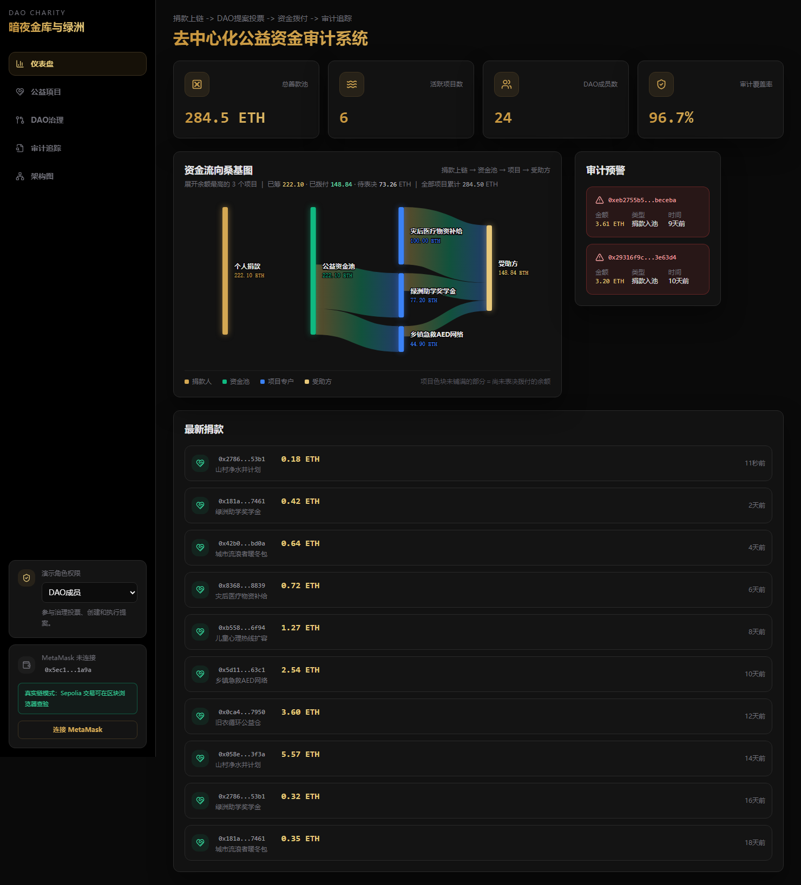
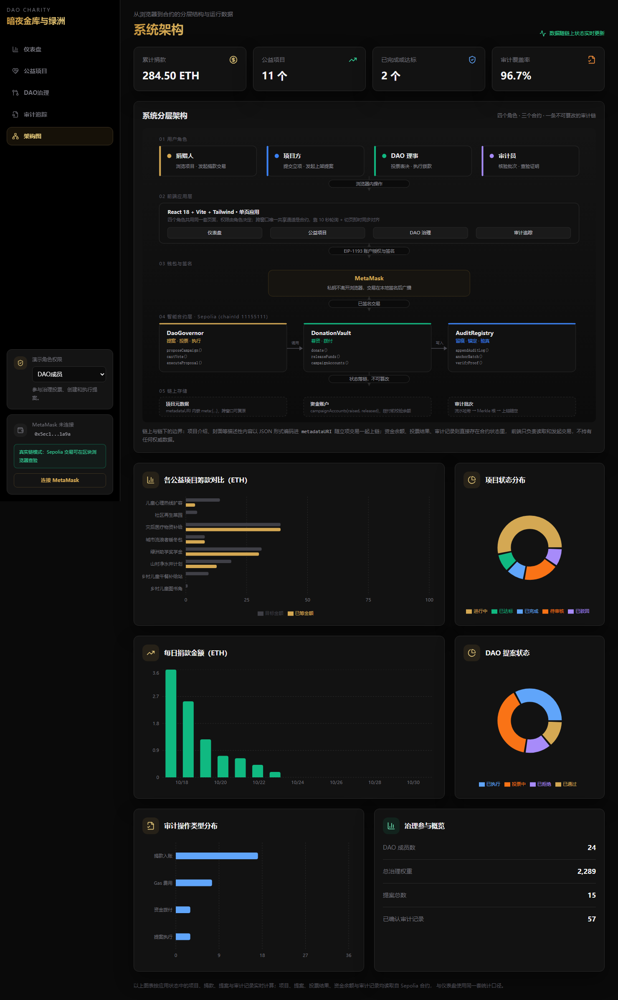
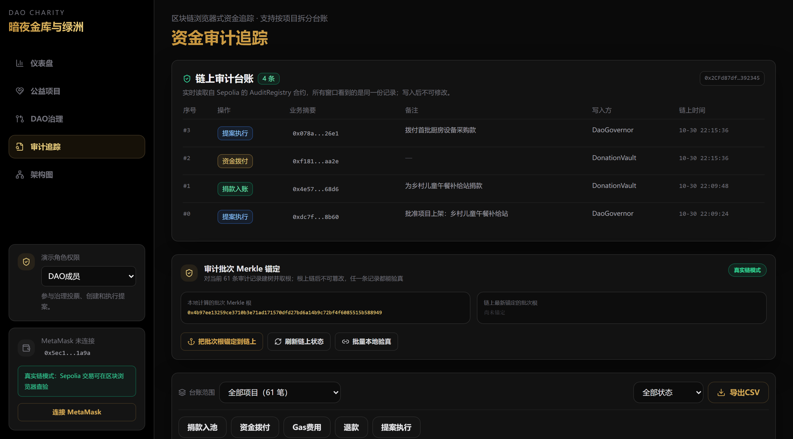

# 去中心化公益资金审计系统

> 用智能合约与 DAO 治理回答公益领域最难的一个问题：**钱到底去哪了**。

捐款直接进入链上金库并按项目分账；项目上线要经 DAO 成员投票；每一笔拨款都必须凭链上用款申请单发起，通过表决并越过时间锁后由合约自动转账；所有关键动作同步写入审计合约，可做 Merkle 证明验真。

`React 18` · `TypeScript` · `Solidity 0.8.24` · `ethers v6` · `Ethereum Sepolia`



---

## 一、它解决什么问题

传统公益平台的信任依赖机构背书：捐款人无法确认钱是否真的到了受助方，项目方也难以自证清白。这个系统把四个环节搬到链上，让"信任"变成可验证的代码约束。

| 环节 | 传统方式 | 本系统 |
| --- | --- | --- |
| 捐款 | 进入平台对公账户 | 直接进入链上金库，按 `campaignId` 分账，每笔都有交易哈希 |
| 立项 | 平台内部审核 | 项目方提交上架提案，DAO 成员投票决定是否上线 |
| 拨款 | 机构审批后人工打款 | 必须凭链上申请单发起，投票通过 + 越过时间锁后由合约转账 |
| 审计 | 事后抽查纸质台账 | 关键操作写入审计合约，支持 Merkle 证明逐条验真 |

## 二、系统架构

三层合约职责分离，任一层被攻破都不足以单独转走资金：

| 层 | 合约 | 职责 | 源码 |
| --- | --- | --- | --- |
| 资金层 | `DonationVault` | 收款、分账、用款申请、里程碑拨款、募资失败退款 | `chain/contracts/DonationVault.sol` |
| 治理层 | `DaoGovernor` | 提案、投票、结算、时间锁执行、票权管理 | `chain/contracts/DaoGovernor.sol` |
| 审计层 | `AuditRegistry` | 仅追加审计台账、批量 Merkle 锚定、证明验真 | `chain/contracts/AuditRegistry.sol` |

前端通过 `src/contracts/chainAdapter.ts` 统一读写链上状态，全局状态与动作调度集中在 `src/context/AppContext.tsx`。



## 三、一笔善款如何走完

链上能完整跑通的主链路如下，顺序即业务顺序：

1. **项目方提交项目** → `DaoGovernor.proposeCampaign`，同一笔调用里把项目名、简介、目标金额、受助方写入 `metadataURI`，并把受助方地址登记进金库（`DonationVault.registerCampaign`），每个项目只能登记一次。
2. **DAO 成员投票** → `castVote`，按持币权重计票。
3. **投票期结束** → `tallyProposal` 结算，等待时间锁后 `executeProposal`，项目转为进行中并写入一条审计记录。
4. **捐赠者捐款** → `DonationVault.donate`，金库按项目分账，同时写 `DonationReceived` 事件与审计记录。
5. **受助方提交用款申请** → `requestFunds(campaignId, amount, evidenceHash)`，只有立项时登记的收款地址本人能调用，且必须附材料摘要。**这一步不转账**，只是把"要多少钱、凭什么要"固定到链上。
6. **DAO 成员凭申请单创建拨付提案** → `createFundReleaseProposal(requestId, evidenceHash, title)`。参数里**既没有收款地址也没有金额**：金额取自申请单，收款方取自立项记录；材料摘要与链上锚定值逐字节比对，不一致直接回滚。
7. **再次投票、结算、过时间锁、执行** → `releaseFunds` 把 ETH 转给立项时登记的地址，申请单置 `RELEASED`，里程碑计数 +1。
8. **审计员验真** → 审计页逐条列出链上台账，勾选任意记录生成 Merkle 证明，可在本地或调用合约验真。

倒计时、票数、提案状态全部以合约返回值为准，不是前端自己算的。



## 四、安全设计：六道约束机制

资金安全不靠"管理员自觉"，而是六条写死在合约里的约束：

| 机制 | 合约实现 | 挡住了什么 |
| --- | --- | --- |
| **法定人数** | `quorumBps`（25%），参与票权不足总票权该比例时提案直接判 `REJECTED` | 少数人闭门通过提案 |
| **执行时间锁** | `timelockDuration`，判定通过后还需等待才能执行 | 通过即执行，社区来不及质疑 |
| **票权一次性初始化** | `bootstrapVotingPower` 只能调用一次，之后没有对外发票权入口，调整票权必须走提案投票 | 部署私钥持有者随时给自己加票 |
| **利益冲突回避** | `castVote` 内比对 `vault.campaignRecipient(targetId)`，收款方本人对涉及自己项目的提案直接 `revert` | 收款方给自己批钱 |
| **拨款必须凭申请单** | `createFundReleaseProposal` 只接受 `requestId + evidenceHash`，通用入口 `createProposal` 明确禁止创建 `FUND_RELEASE` 类型 | 跳过申请环节凭空拨款 |
| **冻结权与解冻权分离** | `freezeCampaign` 限 `onlyAuditor`，`unfreezeCampaign` 限 `onlyGovernor` | 审计员既冻又解，把冻结权变成要挟工具 |

此外收款地址由立项记录锁定（提案人改不了），执行结果全部写入审计层，所有交易可在区块浏览器逐笔查验。

## 五、异常场景覆盖

十四类异常场景，每一类都对应合约里的一段 `require`，并有测试用例覆盖：

| # | 场景 | 合约中的处理 |
| --- | --- | --- |
| 1 | 受助方以外的人提交用款申请 | `require(msg.sender == recipient)` |
| 2 | 单次申请超过单期额度 | `require(amount <= targetAmount / milestoneCount)` |
| 3 | 申请不带材料 | `require(evidenceHash != 0)` |
| 4 | 材料被篡改后再提交 | `require(evidenceHash == anchoredEvidence)` |
| 5 | 同一张申请单重复拨款 | `requestProposed[requestId]` + 状态 `PENDING → RELEASED` |
| 6 | 收款方本人给自己的项目投票 | `castVote` 利益冲突检查 |
| 7 | 募资失败退款 | `refund()`：过截止日 + 未达目标额 + 一期都没拨过 |
| 8 | 通用入口绕过申请单 | `createProposal` 拒绝 `FUND_RELEASE` 类型 |
| 9 | 提案未达法定人数 | `_tally` 判 `REJECTED` |
| 10 | 时间锁未过就执行 | `require(block.timestamp >= endTime + timelockDuration)` |
| 11 | 往未登记的项目捐款 | `require(account.registered)`，否则资金会打进没有收款方、没有申请入口的死账户 |
| 12 | 审计员冻结项目 | `freezeCampaign`，捐款/申请/拨付/退款四个入口同时关闭，理由摘要写入审计层 |
| 13 | 审计员自己解冻 | `unfreezeCampaign` 限 `onlyGovernor`，审计员调用直接回滚 |
| 14 | 项目方拿到钱后失联 | 分期拨付 + 材料留存 + 审计员可冻结，后续期数可停 |

需要说明第 14 条的边界：合约能拦住"钱继续往外流"，拦不住项目方线下消失，那部分只能靠法律追责。链上机制解决的是资金流转的可控与可查，不是无限责任。

## 六、链上 / 链下数据边界

前端有 4 个可独立登录的窗口（项目方 / 捐赠者 / DAO 成员 / 审计员），它们之间**唯一的同步通道就是合约**。

| 真上链（可查证） | 链下（仅用于展示） |
| --- | --- |
| 提案编号、类型、票数、状态、起止时间 | 仪表盘统计图表 |
| 拨款金额与收款地址 | 审计页下方的历史明细表格 |
| 捐款金额、交易哈希、区块号 | 项目卡片封面与简介展示图 |
| 项目可拨付余额、已筹金额 | 成员列表、投票权重面板 |
| 链上审计台账（`getRecord` 逐条读取） | — |
| 法定人数、时间锁、总票权 | — |

设计上宁可缩小承诺范围：看板类图表使用前端种子数据，链上事实一律从合约读取，两者在界面上分区展示，不混为一谈。

## 七、智能合约接口

| 合约 | 主要方法 | 事件 |
| --- | --- | --- |
| `DonationVault` | `donate`、`registerCampaign`、`requestFunds`、`cancelRequest`、`refund`、`releaseFunds`、`fundRequests`、`milestoneCap`、`campaignRecipient`、`campaignBalance` | `CampaignRegistered`、`DonationReceived`、`FundRequested`、`FundsReleased`、`RequestCancelled`、`Refunded` |
| `DaoGovernor` | `proposeCampaign`、`createProposal`、`createFundReleaseProposal`、`createVotingPowerProposal`、`castVote`、`tallyProposal`、`executeProposal`、`executionDelay`、`bootstrapVotingPower`、`getProposal` | `CampaignProposed`、`ProposalCreated`、`VoteCast`、`ProposalExecuted`、`VotingPowerChanged`、`ConflictOfInterestBlocked` |
| `AuditRegistry` | `appendAuditLog`、`getRecord`、`anchorBatch`、`verifyProof` | `AuditLogAppended`、`BatchAnchored` |

## 八、本地运行

前端：

```bash
npm install
npm run dev          # http://127.0.0.1:5173/
```

合约部署到测试网：

```bash
cd chain
cp .env.example .env      # 填写 RPC、部署私钥、DAO 成员地址
npm install
npm run deploy:sepolia    # 编译 → 部署三个合约 → 建立授权 → 回填前端地址
```

部署脚本会自动把合约地址写回根目录 `.env.local`，重启前端后侧边栏显示「真实链模式」。

前端有两种运行模式，由 `VITE_CHAIN_MODE` 控制，保证在没有部署合约时也能完整浏览：

- `sepolia`：真实链模式，所有写操作发起真实交易
- `mock`：模拟模式，合约地址缺失时自动降级，链上动作本地模拟

读操作（审计留痕、交易详情）走公共 RPC，不需要钱包；写操作（捐款、提案、投票、执行）需要 MetaMask 签名。

## 九、测试

| 命令 | 覆盖范围 | 用例数 |
| --- | --- | --- |
| `cd chain && npm test` | 合约：权限、额度、材料校验、退款、冻结、迁移 | 69 |
| `npm test` | 前端：金额换算、Merkle、统计口径、摘要生成 | 38 |

合约测试跑在 ganache 内存 EVM 上，不依赖网络与测试币，任何机器离线可跑。前端用 vitest 覆盖 `utils/` 下四个跨页面共用的计算模块——这些逻辑一旦算错，仪表盘和审计页会同时出错。

## 十、Sepolia 部署记录

| 合约 | 地址 |
| --- | --- |
| `AuditRegistry` | `0x83bcf196cC0019166728a64f0a90DBA8fF62D1B0` |
| `DonationVault` | `0x7534605773FB23928764d0dAEdDD6cE89dBd52DF` |
| `DaoGovernor` | `0x9Dd1e73462C24AaD9F8af0aAbc9F4D179a5FC5e9` |

部署参数为演示配置：`votingPeriod` 120 秒、`quorumBps` 2500（25%）、`timelockDuration` 45 秒，四个角色账户各 100 票权且已 bootstrap 锁死。生产环境建议将投票期提升至 3 天、时间锁提升至 1 小时以上。

合约更新后需重新部署，旧地址上的数据在新合约中读不到——这是链上应用的固有特性。

## 十一、技术栈

- **前端**：React 18 + TypeScript + Vite，Tailwind CSS、react-router-dom v6、Recharts、lucide-react
- **链交互**：ethers v6 + EIP-1193（MetaMask），Merkle 树构建与证明验真
- **合约**：Solidity 0.8.24，solc-js 编译、ethers 部署，ganache 内存 EVM 测试
- **测试**：vitest（前端）、Mocha + Chai（合约）
